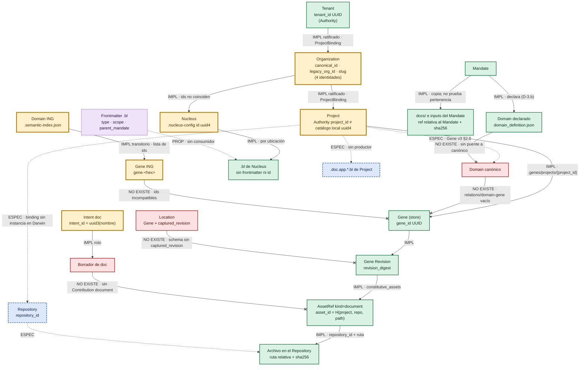

# Vinculación de la documentación con el árbol estructural — relevamiento y mapa v0.1

| Campo | Valor |
|---|---|
| Fecha | 2026-11-03 |
| Tipo | Relevamiento de solo lectura y mapa de preguntas. **No es norma, no propone solución y no toma decisiones de modelo.** |
| Alimenta a | `docs/ANALYSIS/DOC/Programa_Documentacion_Documento_Madre_v0_1.md` (no lo sustituye) |
| Autoridad | José Vigil |
| Máquina | Darwin (Mac Intel, `bell-fibertel-com-ar`), checkout `~/repos/bloom-development-extension` |
| Referencia Git | `refs/heads/main` = `3c7e7d6a56de1d2c3583803fb59b80cbd228fb15` (leído de `.git/refs/heads/main`). No se pudo comprobar si el árbol de trabajo tiene cambios sin commitear: no hubo shell ni Git en la Mac |

### Marcas

| Marca | Significado |
|---|---|
| **IMPL** | Implementado (código citado). Se agrega *sin caller* o *sin instancia en Darwin* cuando corresponde |
| **ESPEC** | Especificado en norma o contrato, sin código |
| **PROP** | Propuesto: research, maqueta, árbol, documento declarado no normativo |
| **NO EXISTE** | Ausencia comprobada en lo revisado |
| **LAGUNA** | No definido; se indica el dueño probable |
| **REAL** | Dato observado en una instalación de Darwin |

### Cómo se trabajó y límites

- La sesión no tuvo shell en la Mac. Los archivos se **copiaron** desde Darwin y se buscaron con `grep` en esa copia. El `rg --files -uu …` y el `rg -n 'I-01|I-25|documentId|repository_id|domain_id|gene_id' docs installer brain` pedidos se reemplazaron por: (a) listados recursivos completos de `docs/` (596 entradas, sin truncar), `installer/nucleus/internal/`, `brain/core/` y `tree/`; (b) búsqueda de contenido sobre los 129 archivos copiados (lista en §7). Lo que no se copió no se buscó por contenido.
- Instalaciones de prueba revisadas (con tu permiso de lectura en esta sesión): `~/Library/BloomNucleus`, `~/repos/elias-repos` y `~/bloom-isolated`. No se modificó nada. De `authority/identity.json` sólo se usó `installation_id`; la clave privada no se leyó en la respuesta y la copia temporal se borró.
- Cuando dos fuentes chocan se muestran las dos con su cita.

---

## 1. Los tres documentos iniciales: procedencia

| Documento | En Darwin | En el Project BTIPS | Versión / identificación | Uso en este relevamiento |
|---|---|---|---|---|
| Documento madre del programa | **Sí.** `docs/ANALYSIS/DOC/Programa_Documentacion_Documento_Madre_v0_1.md`, 338 líneas, 30 079 bytes, sha256 `a92aa351…3ae33df`, modificado 2026-10-31 04:05 (−03) | Sí, misma ruta, creado 2026-10-31 06:59 UTC | v0.1, 2026-10-31. Contenido coincidente en todas las secciones comparadas, incluido el registro I-01 a I-25 (l. 162-190) | Fuente principal. El registro I-01 a I-25 **sí está en Darwin** |
| Relevamiento de DOC | **No encontrado** (no está en `docs/`, `tasks/`, `prompts/`, `.tmp/` ni en las instalaciones de prueba) | **No encontrado** (ni por nombre ni por búsqueda semántica) | Solo aparece citado en el documento madre como "Relevamiento de documentación … (esta sesión)", l. 338 | **No usado.** Lo que de él se conoce llega a través del documento madre |
| Encargo de DOC ("Homologar el intent `doc` a Project, Domain y Gene (borrador v0.1)") | **No encontrado** | **No encontrado** | Citado en el documento madre, l. 7 y l. 233-236 (tramos 1-3) | **No usado.** Igual que el anterior |

**Diferencia de procedencia declarada:** de los tres insumos, solo el documento madre está disponible, y lo está tanto en Darwin como en el Project. Los otros dos no estuvieron disponibles en ninguna de las dos fuentes. En este mensaje solo recibí el encargo de este cowork (el adjunto con los Tramos A y B), que no es ninguno de los dos. Si querés que entren, adjuntalos y los contrasto.

---

## 2. Tramo A — el grafo que existe hoy

### 2.1 Nodos e identidades

| Nodo | Identidad (campos) | Productor | Formato | Dónde (Darwin, REAL) | ¿Más de una identidad? |
|---|---|---|---|---|---|
| **Tenant** | `tenant_id` | Authority remota | UUID | `.ownership.json` → `organization.tenant_id`; `config/nucleus.json` → `onboarding.organizations[].tenant_id`; `authority/project-bindings.json` → `tenant_id`. Los tres dicen `99f15e62-…` (**REAL**) | No en Darwin. En norma hay tres versiones sobre su papel en Location (I-16) |
| **Organization** | (a) `canonical_id` (`ownershipcontract/schema.go:54-73`); (b) `legacy_org_id` (ídem); (c) `slug` (`.nucleus-config.json` `organization.slug`; `org_context.go:40-45` `org_slug`); (d) `id` del Nucleus (`nucleus_manager.py:430`, `uuid4()`); (e) `org_identity.org_id` + `name` (`.nucleus-governance.json`) | Authority (a); migración local (b); Brain `NucleusManager` (c, d); gobernanza local (e) | UUID; `org_<epoch>`; slug; UUID4; texto | (a) `43420c6b-…` en `.ownership.json`, `nucleus.json` y `project-bindings.json`; (b) `org_1792556399` en `.ownership.json` **y** en el nodo Gravity ORGANIZATION (`.gravity/.organization/org_1792556399/node.json`); (c) `elias-repos`; (d) `d7336959-…`; (e) `org_1792556399` con `name: "octocat"` (**REAL**) | **Sí, cinco.** Ver N-01 |
| **Nucleus** | `id` de `.nucleus-config.json`; `nodeId: "nucleus"` en Gravity | Brain `NucleusManager`; Gravity | UUID4; literal | `d7336959-…`; `.gravity/nucleus.node.json` (**REAL**) | El documento madre trata Organization = Nucleus (§6). En los datos tienen ids distintos |
| **Project** | (a) `project_id` del `ProjectBinding` (`project_claim.go:33-44`); (b) `projects[].id` del catálogo local (`nucleus_manager.py:510`, `uuid4()`); (c) `id` de `linker.py:100` (`uuid4()`); (d) `project_path` / `absolutePath` | Authority (a); Brain `NucleusManager` (b); Brain `ProjectLinker` (c); Conductor/onboarding (d) | UUID; UUID4; UUID4; ruta absoluta | (a) `sample_project` = `48e64446-…` en `project-bindings.json` y `nucleus.json`; (b) `bloom-development-extension` = `bc85cd1b-…` y `josevigil.com` = `dc5662d0-…` en `.nucleus-config.json`. **Los dos conjuntos son disjuntos** (**REAL**) | **Sí.** Ver N-02. `project_catalog.go:49-62` lee (b) y `:143-161` lee (a) |
| **Repository** | `repository_id` | Authority `RepositoryBindingStore` (`repository_binding_store.go:16-28`) | UUID (lo exige el store de Genes vía binding) | **No hay ninguna instancia en Darwin.** `~/Library/BloomNucleus/authority/` no tiene store de bindings de Repository | No aplica: no existe. El Project solo tiene una ruta (N-04) |
| **Domain** | (a) `domain_id` ING; (b) `domain.id` del contrato del Mandate; (c) `domainId` de `domain_definition.json`; (d) `DomainID` del nodo Gravity | ING (`genesis_intelligence.py:336-343`); firmante del Mandate (`contract.go:59-62`); `gen_domain.py:96-107`; `structural_projection.go:76` | (a) `dom_<slug>_<32hex>_<4hex>` en código, `dom_{slug}_{hex4}` en la spec; (b, c) texto libre (el test usa `"billing"`); (d) el que reciba | Ninguna instancia en Darwin: `.semantic-index.json` real es `{"indexed_at":…,"entries":[]}` (**REAL**) y no hay `domain_definition.json` | **Sí.** Ver N-06. Canónico: NO EXISTE |
| **Gene** | (a) `gene_id` del store; (b) `gene-<hex>` de ING; (c) `GeneID` + `GenePath` + `MandateID` en Gravity | Store de Genes (`gene/store.go:16`); ING (`genesis_intelligence.py:350`); Gravity (`structural_projection.go:99`) | UUID v1-5; `gene-`+32 hex; libre | Ninguna instancia: no hay `.genes/` en ningún Nucleus de Darwin | **Sí** (I-02, I-03, I-21) |
| **Revision** | `revision_digest` | Materializador (`gene/model.go:89-100`) | `sha256:<hex>` de JSON canónico | Ninguna instancia | La norma la llama `current_revision_id`/`base_revision_id`; el código, `…_digest` (N-09) |
| **Documento** | Dentro de un Gene: `asset_id` = digest de `{project_id, repository_id, repository_relative_path}` (`assets.go:131-143`). Fuera de los Genes: **no tiene identidad propia**; solo ruta | Materializador; en el resto, quien escribe el archivo | `sha256:<hex>`; ruta | Ningún `AssetRef` real. Los `.bl` reales solo se identifican por su ruta | **No existe `documentId` / `document_id`** en lo copiado de `docs`, `brain`, `installer` ni `src` |
| **Mandate** | `mandateId`; `definitionId` + `version` (definición publicada); claves de recibo derivadas por hash | Nucleus; publicador Wisdom | UUID; UUID + semver; `org-<sha256>/installation-<sha256>/mandate-<sha256>/version-<sha256>` | `wisdom-gate/.mandates/13ae5b56-…/mandate_state.json`; `mandate-definitions/72ac3dfb-…/1.0.0/definition.json`; recibo bajo `authority/mandate-delivery/receipts/…` (**REAL**, instalación aislada) | Tres formas de nombrar el mismo Mandate |
| **Intent** | `intent_id` / `uuid` | Brain `IntentManager` | `uuid3(namespace DNS, nombre)` para `dev`/`doc` (`intent_manager.py:64, 131-139`); con `tipo:mandate:nombre` para ING/DIS | — | Para `doc` la identidad depende del nombre: renombrar cambia el id (`intent_manager.py:991-998`) (N-16) |
| **Location** | Sobre `(source, type, id)` | Productor candidato: Orrery | — | NO EXISTE (Closure v1.1 l. 10: `NOT_SUPPORTED`) | — |
| **Installation** (no pedido; aparece en los bindings) | `installation_id` | Authority local; ownership | UUID; 32 hex | `authority/identity.json` = `c8afcc01-…` (y `source_ref: installation:c8afcc01-…` en el binding); `.ownership.json` = `6596ecbf…` (**REAL**) | **Sí.** Ver N-03 |

### 2.2 Relaciones entre documento y estructura

| # | De → a | Quién la declara | Dónde se persiste | ¿Ratificada? / evidencia | Estado |
|---|---|---|---|---|---|
| R1 | Documento → Gene (vía Revision) | Contribution con `assets[]` de `asset_kind=document` | `<nucleus-root>/.genes/projects/{project_id}/revisions/` (`constitutive_assets`, `model.go:95`) | Sí, por diseño: `RatificationEnvelope` con permiso `gene.contribution.ratify` (G1 §11.1; `gene_ratification.go:19-38`). Sin emisor productivo | IMPL sin caller; sin instancia en Darwin |
| R2 | Documento → Repository | El mismo `AssetRef` | Ídem (`repository_id` + `repository_relative_path`) | Resuelto por un binding de Authority con digest (`assets.go:25-47`) | IMPL; **sin binding en Darwin** |
| R3 | Documento → Project | El mismo `AssetRef` (`project_id`) y la partición del store | Ídem | Debe coincidir con el Project del store (`assets.go:52-54`) | IMPL |
| R4 | Documento → Domain | Nadie de forma directa. Solo Domain↔Gene→documento | `relations/domain-gene/` creado vacío (`store.go:79`) | La norma exige N:M ratificada (Gene v3 inv. 13, §7.4) | Directa: NO EXISTE. Indirecta: ESPEC |
| R5 | Documento → Organization | Por ubicación: los `.bl` de gobernanza viven en `.bloom/.nucleus-{org}/` | Filesystem | No. La única mención de la organización dentro de un archivo es `Organization: elias-repos` (slug) en el cuerpo de `.ai_bot.sovereign.bl` (**REAL**) | IMPL por ubicación; sin identidad |
| R6 | Documento → Tenant | Nadie | — | — | NO EXISTE (documental) |
| R7 | Documento → Mandate | `nucleus mandate create --docs` copia a `{mandatesRoot}/{id}/docs/` y registra `docsProvided` (`mandate.go:146-210`); el contrato firma `inputs[]` `{ref, sha256, size}` (`contract.go:64-68`) | `.mandates/{id}/` | La firma prueba integridad, no pertenencia ("no prueban pertenencia constitutiva", Closure v1.1 l. 52) | IMPL |
| R8 | `domain_definition.json` → Domain declarado | Brain `gen_domain` produce; Nucleus escribe (`mandate_gen_activity.go:209`) | `{MandatesRoot}/{mandateId}/domain_definition.json` | Procedencia "declarada por un Mandate", nunca canónica (D-3.b, Decisiones v1.1 l. 182-183). Lleva `sources[{ref, sha256}]` | IMPL; sin instancia en Darwin |
| R9 | Borrador de `doc` → Project | Brain (`doc`) | `<project>/.bloom/.intents/` | No; `mandate_id`, `domain` y `scope` se ignoran para `doc` (`intent_manager.py:90-100`) | IMPL roto (DOC spec §7) |
| R10 | Borrador de `doc` → Gene | Nadie | — | — | NO EXISTE (D-01) |
| R11 | Action `doc` → Mandate | Definición publicada: `{action_id: doc-3, intent_type: doc, depends_on: [dis-2]}` sin `artifactRef` (**REAL**, `definition.json` de la puerta Wisdom) | Definición y contrato v4 | Firmada | IMPL como declaración; no se despacha (D-10) |
| R12 | Location → documento | Vía Gene + `captured_revision` | — | Gene v3 §2.8, §7.7 | ESPEC; el schema no tiene el campo (I-19) |
| R13 | `.bl` → Mandate / scope (frontmatter `parent_mandate`, `scope`) | El propio archivo | Encabezado YAML | No | PROP (`tree/bloom/bloom_bl_frontmatter_spec.txt`); ningún `.bl` real lo tiene y ningún código lo lee |
| R14 | Project → `.doc.app.{architecture,workflow,implementation}.bl` | — | `<project>/.bloom/.project/` | — | ESPEC en árbol/maqueta, sin productor (D-14) |
| R15 | Domain ING → lista de Genes | ING | `.cache/.semantic-index.json` → `domains[id].genes[]` | No ratificada; "compatibilidad transitoria" (Gene v3 §8) | IMPL transitorio; en Darwin el archivo tiene otra forma (N-05) |

### 2.3 Estructura interna de un documento en cada sistema

| Sistema | Campos o metadatos | Tipo o categoría | Convención de nombre |
|---|---|---|---|
| Activo `document` de Genes (`model.go:53-60`) | `asset_id`, `project_id`, `repository_id`, `asset_kind`, `repository_relative_path`, `observed{sha256, size_bytes}`. **No lleva `gene_id`**: el Gene lo recibe por la Revision | `asset_kind` ∈ {`file`, `document`, `test`} (`assets.go:65`) | Ruta relativa con `/`, sin `.`/`..`, sin symlinks (`assets.go:149-163`) |
| Contribution (`model.go:69-82`) | `contribution_id`, `project_id`, `gene_id`, `base_revision_digest`, `mandate_id`, `intent_id`, `declared_function`, `assets[]`, `ratification`, `stable_provenance`, `contribution_digest` | **No tiene tipo.** Los requisitos hablan de "Contribution de tipo `document`" (N-10) | UUID |
| `.bl` reales de Nucleus (Darwin) | Ninguno. Markdown plano con título `#` | Implícita por carpeta: `.core/`, `.governance/{architecture,quality,security}/` | `.<nombre>.bl` con punto inicial |
| `.bl` según la spec de frontmatter (PROP) | `type`, `scope`, `bloom_version`, `timestamp` (requeridos); `intent_stage`, `tags`, `vector_ref`, `parent_mandate`, `author` | `type` ∈ {`dev_instruction`, `doc_instruction`, `dev_rule`, `doc_rule`, `ai_bot`, `strategy`, `governance`, `meta`}; `scope` ∈ {`nucleus`, `project`, `intent`} | Id en ChromaDB = ruta relativa a la raíz de `.bloom` (l. 175-179) |
| `.bl` de Project según el árbol (ESPEC de maqueta) | Sin metadatos | `.doc.app.architecture.bl` ("qué es"), `.doc.app.workflow.bl` ("cómo se utiliza"), `.doc.app.implementation.bl` ("cómo se ejecuta"); más `.doc.rules.bl`, `.doc.instructions.bl` (`bloom_project_desc_tree.txt:4, 32, 542-580`) | `.doc.app.<tipo>.bl` |
| `.bl` de la extensión | Sin metadatos | `FileCategory` `config`/`docs` según la carpeta (`NucleusStrategy.ts:62-71`) | `.organization.bl`, `about.bl`, `business-model.bl`, `policies.bl`, `protocols.bl` (`:183-192`) |
| `.bl` histórico `docs/VERSIONS/v1.0.1/bloom-nucleus_v1.0.1.bl` | `<DOCUMENT filename="bloom-unified-specs.md">` y una spec de 18 secciones | Ninguno | **No representa el formato actual**: es un volcado de spec, no un archivo de gobernanza |
| `domain_definition.json` (`gen_domain.py:96-107`) | `schemaVersion`, `mandateId`, `contractDigest`, `domainId`, `name`, `purpose`, `boundaries`, `concepts`, `decisions`, `sources[{ref, sha256}]`. **Sin `projectId`, `organizationId` ni Genes** | — | Nombre fijo exigido por el contrato (`contract.go:154-155`) |
| Documentos de un Intent `doc` | `.doc_state.json` `{uuid, type, status, steps, …}` (DOC spec §1); `.context/.context.json`; `.codebase*.json`; nunca `.docbase*.json` | Ninguno | Carpeta `.{slug}-{uuid3[:8]}` (`intent_manager.py:141-142`) |
| `docs/` del Mandate | Nombres de archivo en `docsProvided`; `inputs[]` `{ref, sha256, size}` | Ninguno | Copia plana en `docs/` (`mandate.go:196-210`) |
| Documentos del propio repo (`docs/`) | Encabezado humano: **Estado**, Versión, Fecha, Autoridad, Supersede/Reemplaza. En la muestra copiada, 44 de 65 `.md` tienen "Estado" | De facto: normativo / contrato / requerimientos / research / propuesta / informe | `<Tema>_<Subtema>_v<M>_<m>.md`; carpeta = área o Work (`GENES/`, `ANALYSIS/ORRERY/…`) |

### 2.4 Patrones de pertenencia que existen hoy

| Patrón | Dónde | Quién lo respeta | A qué objeto apunta |
|---|---|---|---|
| **Registro en una Gene Revision** (`constitutive_assets`) | Store de Genes | El materializador; solo tests y fixtures (`gene/testdata/authorized_first_gene.json`) | Gene + Project + Repository. Es el único vínculo ratificable (documento madre §3.2) |
| **Ubicación en carpeta** | `.bloom/.nucleus-{org}/.core/` y `.governance/*/` | Brain `NucleusManager` (`nucleus_manager.py:158-194`) al crear el Nucleus | Organization, por el slug de la carpeta |
| **Ubicación en carpeta** (otra convención) | `.bloom/core/`, `.bloom/organization/`, `.bloom/projects/` | Extensión (`NucleusStrategy.ts:62-71`). **No coincide** con el layout real `.bloom/.nucleus-{org}/.core/` (N-13) | Organization / Project, por ruta |
| **Archivo por Project vinculado** | `overview.bl` en `<nucleus>/.bloom/brain/projects/{nombre}/` y `_index.bl` | Brain `ProjectLinker` (`linker.py:320-323, 355`) | Project, por **nombre** de carpeta |
| **Encabezado YAML** | Spec `.bl` frontmatter | Nadie (PROP; sin productor ni lector) | `scope` nucleus/project/intent; `parent_mandate` |
| **Copia bajo el Mandate** | `.mandates/{id}/docs/` | Nucleus | Mandate (no prueba pertenencia a Domain/Gene) |
| **Índice aparte** | `.cache/.semantic-index.json` (Domain→Genes), `.relations/.project-links.json`, `.nucleus-governance.json manifest.projects` | ING; nadie escribe los otros dos en Darwin (vacíos, **REAL**) | Domain→Gene; Project↔Project |
| **Encabezado y carpeta humanos** | `docs/` del repo | Autores (José, coworks, Codex) | Área o Work, no Gene/Domain/Project |

Respuesta a tu duda ("si lo del punto 3 del Tramo B tiene alguna convención ya usada"): **hay dos convenciones de declaración, ninguna con efecto**. Una es la propuesta de frontmatter `.bl`, con `scope` y `parent_mandate`, sin productor ni lector. La otra es la ubicación por carpeta, que sí se usa, pero con dos layouts que no coinciden. La única declaración que el código verifica es el registro en la Revision del Gene, y no tiene caller productivo.

### 2.5 Inconsistencias

#### 2.5.1 Registro I-01 a I-25 del documento madre: qué cambia con este relevamiento

| ID | Efecto de este relevamiento |
|---|---|
| I-02, I-03 | Se agrega la forma de Gravity: `GeneRef{MandateID, GenePath}` y `ParentID` = Mandate (`structural_projection.go:99`), en el modelo "Gene bajo el Mandate" |
| I-12 | **Agravado**: la instancia real de `.semantic-index.json` en Darwin tiene una forma distinta a la que lee ING (N-05) |
| I-13 | Confirmado y ampliado: en Darwin no hay ningún `domain_definition.json` real; su forma no tiene Project ni Organization (§2.3) |
| I-14 | Se suma un tercer alcance: el Domain del contrato es por Mandate, y el Mandate tiene un Project (`contract.go:22-26`) |
| I-16 | En Darwin el `tenant_id` es coherente en los tres lugares; la inconsistencia sigue siendo normativa |
| I-18, I-19 | Sin cambios. Darwin no tiene datos para probarlos |
| I-22 | Confirmado: `intent_manager.py:97` ignora `mandate_id` para `dev`/`doc` |
| Resto | No contrastados de nuevo; se mantienen como están |

#### 2.5.2 Inconsistencias nuevas (numeración provisional N-xx; la numeración definitiva la asigna el documento madre)

| ID | Tema | Versión 1 (cita) | Versión 2 (cita) |
|---|---|---|---|
| N-01 | Identidad de Organization | `canonical_id` `43420c6b-…` (`.ownership.json`, `nucleus.json`, `project-bindings.json`) | `org_1792556399` (`legacy_org_id`; nodo Gravity ORGANIZATION; `.nucleus-governance.json`), slug `elias-repos`, id de Nucleus `d7336959-…` y `name: "octocat"`. Ninguna fuente declara cuál de estas identidades usa Gravity cuando hay `canonical_id` |
| N-02 | Catálogo de Projects | Authority/onboarding: `sample_project` `48e64446-…` | `.nucleus-config.json`: `bloom-development-extension` `bc85cd1b-…` y `josevigil.com` `dc5662d0-…`, generados con `uuid4()` en el escaneo (`nucleus_manager.py:510`). Conjuntos disjuntos; `linker.py:100` genera un tercer `uuid4()` al vincular. El repo que contiene este programa documental tiene id local y **no tiene binding** de Authority |
| N-03 | Identidad de la instalación | `c8afcc01-…` (UUID; `authority/identity.json`; `source_ref` del binding) | `6596ecbf…` (32 hex; `.ownership.json installation.installation_id`) |
| N-04 | Repository | Norma: Project→Repository 0..N ratificado (Vocabulario v1.1 l. 94); G1 exige `repository_id` y binding (§4, §11.2) | Darwin: ningún binding ni `repository_id`. El Project solo tiene `project_path`. Vocabulario: "sin dato físico aún" (l. 290) |
| N-05 | Forma de `.semantic-index.json` | Creación del Nucleus: `{indexed_at, entries: []}` (`nucleus_manager.py:208-211`; **REAL** en Darwin) | ING exige `{domains: {…}}` (`genesis_intelligence.py:29-32`; ING v1.1 §7.3); Gravity selecciona `domains/<id>/…` (`structural_projection.go:246`) |
| N-06 | Formato de `domain_id` | Spec ING: `dom_{slug}_{hex4}` (ING v1.1 l. 35, 438) | Código ING: `dom_<slug>_<32hex>_<4hex>` (`genesis_intelligence.py:339`); contrato del Mandate: texto libre (`contract.go:59-62`; test `"billing"`) |
| N-07 | Formato de digest | `sha256:<hex>` (`gene/canonical_json.go:19, 46`; schemas ING/DIS) | Hex sin prefijo: `inputs[].sha256` (`contract.go:195-197`), `domain_definition.sources[].sha256`, `ArtifactSHA256` del gen |
| N-08 | Nombres de campos de la misma identidad | camelCase: `organizationId`, `tenantId`, `projectId` (`project_claim.go:22-44`), `actionId`, `intentType` (`contract.go:76-85`), `domainId` | snake_case: `organization_id`, `tenant_id`, `project_id` (`project_binding_store.go:14-24`; store de Genes), `action_id`, `intent_type` (`mandatedefinition/definition.go:55-61`) |
| N-09 | Campos de revisión | `current_revision_id`, `base_revision_id` (Gene v3 l. 20, 120-124) | `current_revision_digest`, `base_revision_digest` (`model.go:74, 105`) |
| N-10 | "Contribution de tipo `document`" | Requisitos de lifecycle, req. 17 y V3 (l. 107, 145) | La Contribution no tiene tipo; el tipo vive en cada asset (`model.go:53-82`). Una Contribution puede mezclar `file`, `document` y `test` |
| N-11 | Qué es un documento para Orrery | Vocabulario v1.1 l. 292: "documentación de un Gene" = resultado de Trabajo, "situado en su Domain" | Gene v3 §2.7 y G1 §4: activo constitutivo de una Revision, situado por el Gene. Universo Fase 1 (no normativo) l. 108: lista declarada de la revisión |
| N-12 | Homónimo "Domain" | `Mandate_Domain_Spec_v1.0.0.md` l. 76: "Work Domain" = intents `.exp`, `dev`, `doc` | Gene v3 §2.6: territorio funcional dentro del Project |
| N-13 | Rutas de los `.bl` | Extensión: `.bloom/core/`, `.bloom/organization/`, `.bloom/projects/` (`NucleusStrategy.ts:62-71, 183`) | Brain: `.bloom/.nucleus-{org}/.core/` (**REAL**) y `<nucleus>/.bloom/brain/projects/{nombre}/overview.bl` (`linker.py:59-61, 320-323`); el documento madre §6 dice `.bloom/projects/` |
| N-14 | Alcance declarable de un `.bl` | Spec de frontmatter: `scope` ∈ {nucleus, project, intent}; nota pendiente "relación entre `parent_mandate` y `gene_id`" (l. 57-61, 231) | Programa documental: niveles Tenant, Organization, Project, Domain y Gene (documento madre, alcance) |
| N-15 | Dos productores de `.core/.nucleus-config.json` | Brain v2.0: `type`, `id`, `organization`, `projects[{id, name, localPath, absolutePath, …}]` (**REAL** en elias-repos) | Instalación aislada de la puerta Wisdom: solo `{projects: [{id, absolutePath}]}` (**REAL**). `project_catalog.go:58-62` lee solo `id`, `absolutePath` y `localPath` |
| N-16 | Identidad del Intent `doc` | Gene `Origin.intent_id` debe ser inmutable (Gene v3 inv. 3-4; `model.go:34-38`) | `doc` usa `uuid3(DNS, nombre)`: dos Projects con el mismo nombre de intent colisionan y renombrar cambia el id (`intent_manager.py:131-139, 991-998`) |
| N-17 | Raíz de las rutas de "un mismo documento" | Asset de Gene: relativa al Repository (`assets.go:68`; G1 §4) | Input del Mandate: relativa al directorio del Mandate (`mandate_intent_activity.go:346`); frontmatter: relativa a `.bloom` (spec l. 178); `docsProvided`: solo nombre de archivo |
| N-18 | ¿Un activo puede pertenecer a varios Genes? | El `asset_id` no incluye `gene_id` (`assets.go:131-135`), así que nada técnico lo impide | Ninguna regla lo permite ni lo prohíbe (traspaso Darwin 2026-10-30 l. 43). ING distribuye archivos sin duplicados **en un intercambio** (ídem) |

### 2.6 Diagrama del grafo actual

Código: verde con línea llena = IMPL; azul con raya = ESPEC; violeta punteado = PROP; rojo = NO EXISTE; ámbar con borde grueso = nodo con identidades que chocan. Flecha `--x` = la relación se corta ahí.

**Dónde se corta:** el único camino continuo de documento a estructura es Tenant → Organization → Project → Gene → Revision → AssetRef → archivo. En código está entero; en Darwin, vacío. Le faltan tres cosas: una instancia de Repository, un caller productivo y un emisor de ratificación. Fuera de ese camino, todo documento queda colgado de una carpeta (Organization y Mandate) o de nada (Domain y Tenant).

---

## 3. Tramo B — qué habría que definir (sin decidir)

| # | Pregunta | Opciones que aparecen en las fuentes | Costo e implicancias | Dueño probable |
|---|---|---|---|---|
| B1 | **Identidad estable del documento entre sistemas** | (a) `asset_id` = H(`project_id`, `repository_id`, ruta), IMPL en G1 §4. (b) Huella de contenido `sha256`, presente en Genes, inputs del Mandate y `sources` de `domain_definition`. (c) Ruta relativa a `.bloom` como id de ChromaDB (frontmatter, PROP). (d) Un id propio: **ninguna fuente lo propone**. (e) `uuid3(nombre)` para artefactos de Intent | (a) Requiere que exista Repository (N-04) y no sobrevive a un renombre o movimiento. (b) Cambia con cada edición, así que identifica versiones, no documentos; además hay dos formatos (N-07). (c) Solo sirve dentro de `.bloom` y choca con N-17. (d) Construcción nueva y fuera de toda fuente. (e) Colisiona entre Projects (N-16) | Genes (a, b); BISP/Brain (c); LAGUNA (d) |
| B2 | **¿Hace falta una clasificación?** | En las fuentes: `asset_kind` {file, document, test} (IMPL). `type` del frontmatter {dev/doc_instruction, dev/doc_rule, ai_bot, strategy, governance, meta} (PROP). `.doc.app.{architecture, workflow, implementation}` más `.doc.rules` (árbol, ESPEC de maqueta). Gobernanza {architecture, security, quality} (IMPL, plantillas). Estado de documentos del repo {normativo, contrato, requerimientos, research, propuesta} (convención humana) | `asset_kind` no distingue clases de documento. Las demás no tienen lector. Ninguna clasificación cubre Domain ni Tenant | LAGUNA: Genes para `asset_kind`; Brain/`doc` para `.doc.app.*` |
| B3 | **¿Cómo declara un documento su pertenencia?** | (a) Dentro del documento: frontmatter (PROP). (b) En un índice aparte: `.semantic-index.json`, `_index.bl`, `.project-links.json` (IMPL o vacíos). (c) En un registro gobernado: `constitutive_assets` de la Revision (IMPL) y relación Domain↔Gene (ESPEC, directorio vacío) | Frente a la regla "la pertenencia no se infiere" (Gene v3 inv. 11-12): (a) es autodeclaración: sin ratificación externa vale como propuesta, no como prueba (según los requisitos de lifecycle l. 115, G1 §11.2 rechaza `human_decision` genérico, tests exitosos o contenido previo como evidencia). (b) es proyección: debe reconstruirse desde la fuente canónica, nunca al revés (inv. 15). (c) es la única que ratifica, y hoy solo existe a nivel Gene | Genes (c); Authority (ratificación); Brain/BISP (a, b) |
| B4 | **Pertenencia a más de un objeto** | Técnicamente posible en G1, porque el `asset_id` no lleva Gene (N-18). Domain↔Gene es N:M (inv. 13), así que un documento de un Gene es alcanzable desde varios Domains. No hay regla explícita para un documento constitutivo de dos Genes | Permitirlo obliga a definir qué pasa con la Knowledge Determination cuando un cambio en un Gene invalida el documento compartido por otro (requisitos 16-18). Prohibirlo choca con documentos transversales | **LAGUNA. Dueño: Gene v3.0** (el traspaso del 2026-10-30, l. 43, lo deja abierto) |
| B5 | **Relación entre niveles** | Organization: plantillas fijas sin consumidor (D-13). Project: `overview.bl` por nombre. Domain: sin documento canónico; `domain_definition.json` es contenido declarado. Gene: Revision. Orrery: "lista declarada de documentos de la revisión" (Universo F1 l. 108, no normativo) | Ninguna fuente define agregación hacia arriba (Gene→Domain→Project) ni herencia hacia abajo (gobernanza de Org→Projects) | LAGUNA: Genes/Domain para el tramo Domain-Gene; Brain/Nucleus para Organization |
| B6 | **Qué hace a un documento parte de la infraestructura** | En el nivel Gene: `asset_id` + `repository_id` resuelto por binding + digest observado + Contribution ratificada (`RatificationEnvelope`) + `Origin` {mandate, intent, decision} + Knowledge Determination (requisitos 16-20, ESPEC, sin código: no hay "knowledge" en `gene/*.go`) | En los otros niveles no hay criterio en ninguna fuente | Genes y Authority (nivel Gene); LAGUNA (resto) |
| B7 | **Compatibilidad con el grafo de Project y Nucleus** | **Coincide:** `project_id` UUID de Authority = partición del store de Genes (`store.go:61-72`); `tenant_id` coherente. **Contradice:** ids locales de Project (N-02); id legacy de Organization en Gravity (N-01); Repository inexistente (N-04); forma de `.semantic-index` (N-05); Domain ids (N-06); Gravity con el Gene bajo el Mandate (I-03) | Cualquier modelo documental que se ancle al Project hereda N-02: hay que elegir qué id de Project es el ancla | Authority + Brain (N-01, N-02); Genes (N-04) |

### Preguntas que dependen de decisiones tuyas (no las tomo)

1. ¿Qué identidad de Organization es el ancla de la documentación de nivel Organization: `canonical_id`, `legacy_org_id`, slug o id de Nucleus? (N-01)
2. ¿El ancla de Project es solo el `project_id` con binding de Authority? En ese caso, este mismo repo (`bloom-development-extension`) hoy no podría anclar sus documentos, porque solo tiene id local. (N-02)
3. ¿Los documentos de la plataforma (este `docs/`) entran al grafo como documentos de un Project, o quedan fuera del alcance del programa?
4. ¿Hace falta producir un Repository real en Darwin antes de cualquier piloto con `AssetRef` (P-B del documento madre)? (N-04)
5. ¿Un documento puede ser constitutivo de más de un Gene? (B4; dueño Gene v3.0)

---

## 4. Lo que no pude verificar y cómo cerrarlo

| # | No verificado | Por qué | Cómo cerrarlo |
|---|---|---|---|
| V1 | Búsqueda de contenido en **todo** el repo (`rg -uu`) | Sin shell en la Mac; se buscó solo en 129 archivos copiados | Corré vos, desde la raíz: `rg --files -uu \| rg '(\.bl$\|domain_definition\.json$\|[Dd]ocument\|[Dd]oc)'` y `rg -n 'documentId\|document_id\|repository_id\|domain_id\|gene_id' docs installer brain src webview backend`, y pegame la salida |
| V2 | Cambios sin commitear sobre `3c7e7d6` | Sin Git | `git -C ~/repos/bloom-development-extension status --short` |
| V3 | `domain_definition.json` real | No hay ninguno en Darwin (`elias-repos/.mandates` vacío; la puerta Wisdom solo tiene `mandate_state.json`) | Leer la instancia de Windows, donde está instalado el Mandate (estado local que no viaja con Git), o correr el vertical `gen` en Darwin |
| V4 | Productor de `RepositoryBindingStore` | Solo se revisaron los paquetes copiados de `installer/nucleus/internal` | Búsqueda completa de `RepositoryBindingStore{` y `repository-bindings` en `installer/` |
| V5 | `installer/conductor`, `webview`, `backend`, `installer/aitap` | No copiados | Copia dirigida si el programa lo pide (Conductor produce identidades de Project, Closure v1.1 l. 19) |
| V6 | `~/bloom-isolated` completo | El listado se truncó en 2000 entradas; se revisaron `workspaces/`, `home/Library/BloomNucleus/{mandate-definitions, authority}` y `backend-state/v3/r2/bloom-mandates` | Listar `evidence/` y `home/Library/BloomNucleus/config` por separado |
| V7 | `authority/state.json` y registros del backend (Tenant/Organization) | No leídos | Pedir los campos concretos que se quieran contrastar |
| V8 | El relevamiento y el encargo de DOC | No están en Darwin ni en el Project | Adjuntalos y los contrasto contra este mapa |
| V9 | `.bloom` de Projects reales (`josevigil.com`, etc.) | Fuera de las carpetas autorizadas | Autorizar la lectura si se quiere confirmar que no hay `.doc.app.*.bl` reales |

---

## 5. Archivos leídos y su carácter

Las líneas indicadas son las citadas. Además, los documentos de norma y de contrato se leyeron completos en las secciones que tratan de identidad, documento, Domain, Gene y Location.

**Norma (normativo o aprobado)**
- `docs/GENES/COGNITUUM_GENE_CONCEPT_v3_0.md` — "fuente conceptual canónica ratificada" (l. 3); l. 1-30, 75-85, 114-130, 192-239, 283-294.
- `docs/ANALYSIS/ORRERY/Orrery_Vocabulario_Normativo_v1_1.md` — normativo (l. 3); l. 41, 66-94, 147-180, 284-295.
- `docs/ANALYSIS/ORRERY/Orrery_Decisiones_Arquitectonicas_v1_1.md` — normativo (l. 3); l. 182-183, 284, 319.
- `docs/ANALYSIS/ORRERY/EXPERIENCE/Orrery_Experience_Model_v1_0.md` — normativo (l. 8); l. 459, 612.
- `docs/ANALYSIS/ORRERY/LOCATION/ORRERY_LOCATION_MATERIAL_CLOSURE_v1_1.md` — research cerrado y aprobado; l. 10-20, 45-56, 142, 180, 323, 398-410.
- `docs/MANDATE/MANDATE_PROGRAM_CANONICAL_SOURCE_v0_1.md` — Fase 0 aprobada; l. 1-13, 74-90, 150-170.
- `docs/ANALYSIS/DOC/Programa_Documentacion_Documento_Madre_v0_1.md` — documento madre (relevamiento y plan; no autoriza implementación); completo.

**Contrato o requerimientos (ESPEC)**
- `docs/GENES/COGNITUUM_GENE_CANONICAL_PERSISTENCE_MATERIALIZATION_CONTRACT_v0_1.md` — contrato físico G1; l. 1-27, 61-81, 192-214, 243-282.
- `docs/GENES/GENE_DOCUMENT_LIFECYCLE_REQUIREMENTS_v0_1.md` — requerimientos; l. 1-29, 70-133, 141-147, 180-200.
- `docs/BSIP/TYPES/DOC_Intent_Spec_v1_0.md` — "confirmado contra código"; l. 1-12, 42-150, 170-196.
- `docs/BSIP/TYPES/ING_Intent_Spec_v1_1.md` — confirmado; l. 1-8, 28-39, 58, 99-102, 369-442.
- `docs/BSIP/TYPES/DIS_Intent_Spec_v1_0.md` — confirmado; l. 4-6, 51, 125, 213-214.
- `docs/MANDATE/BLOOM_Mandate_Universal_Schema_v1_2_0.md` — RFC/addendum de Gravity; no trata documentos (l. 1-14, 82, 143). Las versiones v1.0.0 a v1.1.0 que extiende **no están** en `docs/MANDATE/`.

**Propuesta, research o maqueta (PROP)**
- `docs/ANALYSIS/ORRERY/Orrery_Traspaso_Cloud_Darwin_Estado_Recoleccion_y_Genes_2026-10-30.md` — "no es norma" (l. 6); completo.
- `docs/ANALYSIS/ORRERY/VISUAL/Orrery_Estructura_Base_Universo_Fase1_Definicion_v0_1.md` — no normativo (l. 6); l. 100-110, 168-176.
- `docs/ANALYSIS/ORRERY/LOCATION/Orrery_LocationSnapshot_v0.md` — propuesta contractual; l. 1-8, 48, 80, 93, 162, 582, 659.
- `docs/MANDATE/Mandate_Domain_Spec_v1.0.0.md` — especificación de feb-2026 con nota de deprecación; l. 1-15, 76.
- `tree/bloom/bloom_bl_frontmatter_spec.txt` — spec v5.0 sin consumidor; completo.
- `tree/bloom/DESC/bloom_project_desc_tree.txt` (l. 1-32, 327-580), `tree/bloom/bloom_project_tree.txt` (l. 250-262), `tree/elias-repos_tree.txt`.
- `docs/VERSIONS/v1.0.1/bloom-nucleus_v1.0.1.bl` — histórico; l. 1-40 e índice de secciones.
- `prompts/copilot_contracts/.copilot.doc.intent.bl` — l. 1-40.

**Código (IMPL)**
- Genes: `installer/nucleus/internal/gene/model.go` (completo), `assets.go` (completo), `store.go` (l. 16-120), `materializer.go` (l. 12-28, 92-235), `canonical_json.go` (l. 19, 40-67), `testdata/authorized_first_gene.json`.
- Core: `internal/core/project_catalog.go` (l. 14-190), `internal/core/org_context.go` (l. 25-46, 77-99, 292-324).
- Governance: `internal/governance/ownershipcontract/schema.go` (l. 10-136); `internal/governance/create.go` y `ownership.go` (copiados, solo búsqueda).
- Authority: `repository_binding_store.go` (l. 16-62, 115-153), `project_binding_store.go` (l. 14-31), `project_claim.go` (l. 15-46), `gene_ratification.go` (l. 19-43), `identity.go` (l. 18-27); `roles.go`, `snapshot.go`, `tenant_fetch.go`, `registration.go` (copiados, solo búsqueda).
- Mandate: `orchestration/mandatecontract/contract.go` (l. 15-100, 135-200), `orchestration/activities/mandate_gen_activity.go` (l. 40-61, 85, 195-250), `orchestration/activities/mandate_intent_activity.go` (l. 335-360), `orchestration/commands/mandate.go` (l. 72-210), `mandatedefinition/definition.go` (l. 50-122).
- Gravity: `gravity/structural_projection.go` (l. 19-110, 231-294), `gravity/model.go` (l. 5-26, 93-95).
- Brain: `core/intent/gen_domain.py` (completo), `core/intent/genesis_intelligence.py` (l. 29-74, 107-120, 280-356), `core/nucleus_manager.py` (l. 158-212, 425-435, 500-520), `core/project/linker.py` (l. 10-114, 170-200, 313-355), `core/intent_manager.py` (l. 35, 64, 90-145, 507, 979-1000), `core/intent/schema/{ing_classification_result_v1, dis_mapping_result_v1}.json`.
- Extensión: `src/strategies/NucleusStrategy.ts` (l. 40-80, 183-192).

**Estado operativo real de Darwin (REAL)**
- `~/repos/elias-repos/.bloom/.nucleus-elias-repos/`: `.core/{.nucleus-config.json, .meta.json, .rules.bl, .policies.bl, .standards.bl, .ai_bot.sovereign.bl}`, `.governance/{architecture/.patterns.bl, architecture/.principles.bl, quality/.code-standards.bl, security/.security-standards.bl}`, `.cache/{.semantic-index.json, .projects-snapshot.json}`, `.relations/.project-links.json`, `.ownership.json`, `.nucleus-governance.json`, `.gravity/{nucleus.node.json, .organization/org_1792556399/node.json}`, `findings/README.md`. El listado completo muestra que `.mandates/` está vacío y que no hay `.genes/`.
- `~/Library/BloomNucleus/`: `config/nucleus.json` (solo `onboarding.organizations`, `active_project_id`, `system_map`), `authority/project-bindings.json`, `authority/identity.json` (solo `installation_id`); listado sin `.bl` ni `domain_definition.json` fuera de `bin/`.
- `~/bloom-isolated/wisdom-20261021-012631/`: `workspaces/wisdom-gate/.bloom/.nucleus-wisdom-gate/{.core/.nucleus-config.json, .mandates/13ae5b56-…/mandate_state.json}`, `home/Library/BloomNucleus/mandate-definitions/72ac3dfb-…/1.0.0/definition.json` (sin `content_base64`).

**Documentos iniciales disponibles solo en el Project:** ninguno. El documento madre está en ambos lados. El relevamiento y el encargo de DOC no están en ninguno de los dos (§1).
